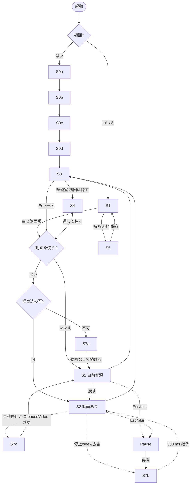

# ヘクサノート 設計書（R2 計画とデザイン）

統合 2026-10-30。起草 5 節（screens・spec・format-architecture・worktable・risks-ledger）を一本にし、疑う役の反論 20 件・矛盾 22 件・不足 20 件を取り込んだ。根拠は catalog の id、map.md の節、モック名。「仮」は推測、「測る」は実測待ち。細部の根拠欄は起草 5 節を引き継ぎ、食い違うときは本書を正とする。

## 0. 読み方と前提（decisions.md の要約）

1. 主経路は同梱曲（PD・CC・自作）＋ MIDI 持ち込み。YouTube は再生と導線だけ。音声解析は入れない。動画なしでも全機能。
2. 六角は混在: ピアノ型が既定、隣接の意味は「辺で次を指す」だけ。W–H は対照。
3. 既定配列は Ableton 型、広い音域は VMPK 型。譜面は配列×同時押し上限の譜面版を持つ。
4. 正六角格子。A–Q の 1/4 ずれは「継ぎ目」。合わない端末は「正六角のまま文字だけで押す」退避。
5. 着地は段別＋奥行き。一本線は対照。同時性は塊／殻で補う。
6. YouTube 再生のプレイに XP・ストリーク・ランキングを付けない。
7. NEAR は難易度固定（入門者 1、音ゲー向け 0）。足場外しは成績連動。自力率は 4 区分。
8. 同時押し上限は既定 2、診断通過で 3〜4。入門者は精度%とランクだけ。比較は同じ譜面版の中だけ。
9. 初回導線は配列選択→同時押しテスト→校正→チュートリアル曲。同期タップは出さない。持ち込みは 2 回目以降。
10. 判定窓 24/100/180（遅れ ×1.3）と 30/90/200、performance.now 主時計、二段校正、R 28 px・最小 24、code 判定・IME 無視、MIT／MPL／Apache のみ、PWA 先行。

語: **譜面版**＝variants[].id。**自前音源**＝同梱曲・持ち込み曲を Web Audio で鳴らす経路。**待ちモード**＝音待ち・フレーズ待ち（練習室 S4 と初回導線 S0d だけ。2026-11-01、decisions #82）。**固定テンポ**＝通常プレイ。

## 1. 画面と遷移

### 1.1 画面一覧（8 群 15 枚）

| id | 画面（役割） | 入口 |
|---|---|---|
| S0a | 配列の確認（刻印の確認とおすすめ配列で開始） | 初回起動 |
| S0b | 同時押しテスト（10 組） | S0a |
| S0c | 校正（メトロノーム 24 打） | S0b |
| S0d | チュートリアル曲（同梱 1 曲を鍵数 3 段階で） | S0c |
| S1 | ホーム／選曲（曲一覧と譜面版） | 2 回目以降の起動 |
| S2 | プレイ（落下・判定・HUD。固定テンポ。動画あり／なし） | S1・S3・S4 |
| S3 | 結果（精度・ランク・内訳・提案・称号） | S2 の終了 |
| S4 | 練習室（待ち・ループ・テンポ段・足場外し・鍵数制限） | S3・S1 |
| S5 | 曲の持ち込み（MIDI→トラック→折り畳み→同期→保存） | S1（2 回目以降） |
| S6 | 設定 | 全画面の歯車 |
| S7a | 埋め込み不可（onError） | S2 の読込 |
| S7b | 同期中（停止・seek・広告） | S2 再生中 |
| S7c | 動画なしへ（時計停止の切替と手動の戻し） | S2 再生中 |
| S7d | 保存できません | 全画面 |
| Pause | 一時停止メニュー | S2 の Esc・blur |

状態変数: 初回か否か（端末プロファイルの有無。sessionStorage でも抑止）、プロファイル、動画の使用（プレイ単位 syncUsed）、譜面版、端末の上限、校正の有無。プレイヤー矩形の前には何も置かない（map §2A RMF）。測ること: 到達・所要秒・離脱、帯の回数、採択率（§4.6）。

### 1.2 遷移図

S3・S4・S5・S6 から S1 へ戻れる。

### 1.3 各画面

**S0 初回導線**（a-03）。目標 5 分（仮）。4 段とも「あとで」（離脱として記録し既定値で先へ）。全段で IME 帯が効く。S0b・S0c は canvas へフォーカスを移し、ボタンは Enter だけで押せる。

- S0a: 鍵盤図（Ableton 型）、刻印の表示（getLayoutMap か JIS／US の選択）、試打欄。折り畳み「別の配列（VMPK 型）」は S1 の既定配列にだけ効く。「刻印は合っていますか」「これで始める」。
- S0b: 10 組（§2.4）、進捗 n/10、押下キーの点灯、1 秒の保持バー、結果 2・3・4。最初の keydown が 229 なら帯を出し組をやり直す。「S・D・F を同時に押して、1 秒そのまま」「スキップ（2 つのまま）」。
- S0c: 音のテスト→「聞こえない」なら校正せず次へ（未校正印）。100 BPM・予備 4 拍・24 打。「平均 −18 ms、ばらつき 12 ms。適用します」／「ばらつきが大きいので適用しません」。
- S0d: S2 の入門者形態、常に Ableton 型。鍵数 1 音→ホームポジション（D F J K）→全鍵。音待ち固定。吹き出し 3 つ（辺ヒント、着地、同時押し）。初回の S3 は「練習室で弾く」を隠す。（2026-10-31、decisions #61: M1 の S0d は固定テンポで、曲を遅く〔60 BPM・間隔 2 拍、仮〕作って代える。音待ちは練習層 M2-03 の後に戻す。→ 2026-11-01、decisions #82: 音待ちへ戻すと決めた〔曲は 60 BPM・間隔 2 拍のまま、段階 3 も練習記録。実装は m2-kickoff 手順 6〕）

**S1 ホーム／選曲**（a-05）。上帯: プロファイル（M1 版では隠す）、端末の上限、校正の有無。曲カード: 曲名、許諾、「動画あり／なしで遊べる」印（文字でも）、長さ、難度 4 軸、自己ベスト（プロファイル×譜面版）、完走印。譜面版の選択: 配列（推奨が先頭）× 上限（端末の上限以下。3〜4 の版には「保証なし: 和音で 3 キー目が無反応なら設定で上限を戻せます」）。持ち込み曲で版が無ければ「この配列／上限の版を作る」。動画を使うかの切替（埋め込み不可を記録した曲は「なし」が既定）。フィルタ・並び（おすすめは密度の低い順）。「曲を持ち込む」は 2 回目以降。

**S2 プレイ**（critic-02、core-01、core-06、tech-04、a-04）。通常プレイは固定テンポ。待ちは S4 と S0d だけ（2026-11-01、decisions #82）。配置は左右分割: 左列にプレイヤー矩形（480×270、下限 356×200）と HUD、右列の全高を落下域＋鍵盤図（§2.5）。セルが自分のキーのセルに重なった瞬間が押し時。辺ヒント（入門者のみ）、和音は塊／殻、ホールドはカプセル。NEAR はセルが押したキーへ半分滑る。判定の返しはセル内の縁 2→6 px・120 ms だけ。演出は落下域と鍵盤図の領域内だけ。通知（トースト・帯）もプレイヤー矩形の外（上帯の直下）に置く（m6 で統一）。HUD: 入門者＝曲名・進行・精度%、音ゲー向け＝＋ランク・ゲージ・コンボ・ハイスピード・FAST／SLOW。失敗は入門者なし、音ゲー向けはゲージ 0 で「途中終了」。帯（矩形の外）: S7b「同期中 … 再開後 300 ms は判定を猶予」、S7c「動画が止まったので、ピアノ音で続けます（戻す）」、IME「半角/全角キーで英数に戻してください」（打鍵は無視、曲は止めない）、自動再生ブロック、S7d。Pause（Esc・blur・visibilitychange）は再開／最初から／やめる。再開は S7b を通る。（2026-10-31、decisions #65、仮: 右列が視口の全高を使う〔§2.5〕ので、S2 の帯は左列のプレイヤー矩形と HUD の下に 1 行で出す。S2 は歯車を出さない。Pause の覆いは右列だけ。一時停止中の Esc は何もしない）

**S3 結果**（a-02、feel-08）。入門者: 精度%・ランク、内訳（ぴったり／よい／おしい／となり＝NEAR／はずれ）、自力率 4 区分の帯、「同時押しが合った割合」、「平均 −12 ms（少し早め）」、オフセット提案（§2.7 のゲートを満たすときだけ）、苦手区間「ミスが集まった 2 小節: 17〜18」→「練習室で弾く」、対象プレイ（§4.4）だけ称号。音ゲー向け: ＋FULL COMBO・最大コンボ・ゲージ終値、FAST／SLOW 比、塊／殻／段またぎの 3 割合、ヒストグラム。動画を使った回は注記「YouTube 再生の曲は端末内だけに記録します」。練習記録（待ち・テンポ≠1.0・鍵数制限）は見出し「練習の結果」で精度%のみ（M1 の実装は精度%と自力率、decisions #70 (c)。2026-11-01、#82 で注記）。途中で動画なしへ切り替わった回はその旨を注記。

**S4 練習室**（learning-01／02／03／05、input-15）。S2 の入門者形態＋右パネル。待ち方: 自前音源は音待ち／フレーズ待ち／固定テンポ、動画ありは固定テンポだけ（待ちは動画の自動停止・再開の反復になる。L-5）。「音待ち: どのノートも自分のキーにはまる位置で止まり、正しいキーを押すと進みます」。ループ: 帯クリックで始点→終点、「ミス 3 回で自動ループ」「ノーミス 2 周で解除」。テンポ段: 動画なし 7 段、動画あり 4 段（効かなければ「この動画ではテンポを変えられません」）。足場外し 9 マス、透明度「手動／成績連動」。自力率「62%（ラベル無しで当てた 31／50）」。鍵数制限（入門者だけ）「D F J K」「8 鍵」「全部」は実行時フィルタ。S3 から入ると苦手 2 小節がループ済み。 注記（decisions #88、2026-11-01、仮）: 「右パネル」は左列のプレイヤー矩形の場所に置く（右列は全高を落下域に使う、§2.5）。S4 は S2 の動画なし形態に練習のパネル（待ち方・テンポ段と自動昇降・ループの帯と自動ループ・自力率・「通しで弾く → プレイ」「ホームへ」）を足した画面で、固定テンポ・1.0・全鍵の回は通常プレイ。歯車は出さない。足場外しの 9 マスは M2-04、鍵数制限の箱は M2-07。 注記（decisions #90、2026-11-01、仮）: 足場外しはパネルの折り畳みの中（ラベルのマスは入門者の既定のノート側「両方」を表せるよう 4×4、手動／成績連動、手動 0〜100% 5% 刻み、音高ごとの棒、リセット、自力率の 4 区分）。α は回の終わりに hexnote.fade へ保存し、退避の間は止める。

**S5 曲の持ち込み**（pipeline-07／04／10、m5）。段ごとに戻れる縦積み。段 1 MIDI（SMF 0/1）。段 2 トラック: 弾くトラック 1 つと伴奏にするトラック（既定: 残り全部、ドラム除く）。段 3 折り畳み 3 択、失われる音数、試聴。段 4 同期（動画を使うときだけ）: 動画 ID、click-to-play、8 拍タップ、残差。段 5 保存: 曲名・作者、難度 4 軸、運指の警告、権利印 private。保存に失敗したら「*.hexnote.json を書き出す」を即座に出す。保存時に配列×上限の譜面版を自動生成（fold は段 3 の選択）。（2026-11-01、decisions #79: 段 4 は M3-03 で組み込む。M2 の S5 は段 1・2・3・5 で、持ち込み曲の sync.sources は空。M2-02 は同期タップの部品と開発ページで閉じる）

**S6 設定**: プロファイル（切替で既定値を一括、「既定へ戻す」）。配列（Ableton／VMPK／対照 W–H、刻印 JIS／US）。幾何（正六角／物理せん断／退避、段ずれの自己申告）。着地・辺ヒント・判定窓・離し窓。同時押し上限（「テストをやり直す」）。校正。ラベル 9 マス。色（グレースケール確認）。演出の予算（標準／控えめ／なし）、低負荷モード（自動／ON／OFF）。音（ガイド音、メトロノーム、空打ち発音、伴奏の音量。動画ありでは「ピアノ音を重ねる」を出さない）。IME 検知時に曲を止める（既定 OFF）。計測盤（§4.6）。データ（記録と持ち込み曲の削除、全持ち込み曲の版を作り直す、書き出し／取り込み、端末プロファイルの初期化）。クレジット（Salamander、同梱曲の権利表）。

**S7 退避状態**（全て矩形の外）。S7a: onError（コードは M3-09 で照合）→「この動画は埋め込みで再生できません」「ピアノ音で遊ぶ」「ホームへ」。S7b: BUFFERING／PAUSED、飛び 250 ms 超→帯、300 ms 猶予。S7c: 可視・PLAYING で時刻 2 秒凍結、かつ pauseVideo() が 500 ms 以内に PAUSED を返したら自動切替＋「戻す」（手動のみ）。pause が効かない間（広告中とみなす）は S7b のまま。S7d: 保存の例外→帯、メモリ内プロファイルで続行、S5 では書き出しを勧める。IME・フォーカス・自動再生ブロックも帯。

## 2. 既定の仕様値

根拠欄は spec 草稿 §1〜§19 を引き継ぐ。ここでは値と変更点。

### 2.1 配列プリセット（code → MIDI）

Ableton 型（既定）: A 段白鍵 A〜; ＝ 60〜76 の白鍵、Q 段黒鍵 W E T Y U O P ＝ 61 63 66 68 70 73 75。VMPK 型: Z 段白鍵 48〜64、A 段黒鍵、Q 段白鍵 60〜76、数字段黒鍵（表は spec 草稿 §1）。原神・Sky 型: 自然音 3 段。W–H（対照）: 48＋2·col＋5·(3−row)。使うキーは JIS／US で同じ 26 文字＋10 数字＋Comma／Period／Slash／Semicolon。VMPK 型の同音は keys が決める（既定「60 以上は Q 段側」）。譜面版の生成器は全配列で「候補が複数なら 60 以上は上の段、60 未満は下の段」（decisions #21、2026-10-30。wicki だけ M-10 まで仮）。刻印: getLayoutMap（Chromium・HTTPS）→無ければ JIS／US の選択（ja なら JIS 既定）。AZERTY・Dvorak は code が同じなので初版は QWERTY 刻印で表示し注記。細部（2026-10-31、仮。実装 src/layout/）: getLayoutMap が読めればその文字（大文字、1 文字でない値は QWERTY）を出し、上の「QWERTY 刻印で表示し注記」は読めないときと読む（decisions #43）。同音の候補と既定の選び方は src/layout/same-pitch.ts に置き、判定は譜面版の keys の鍵だけを正解にする（同音許容は後。#44）。段ずれは [数字–Q, Q–A, A–Z]（ADR 0001）で 0〜1 u、黒鍵の位相は段ずれの小数部の 1/2 からの差で 0.125 以下 合う・0.375 以下 1/4u ずれる・超えて 合わない、配列ごとに効く段間（ableton Q–A、vmpk 数字–Q と A–Z）の最悪で決める（#42）。幾何は 正六角（既定）／物理せん断／退避 で、効く段間が「合わない」なら退避を勧める。退避は鍵盤図を正六角のまま、キー文字を必ず出す（判定・NEAR・辺ヒントは変えない。#45）。

### 2.2 幾何・着地・辺ヒント・和音

格子: pointy-top 正六角、段ごと右へ 1/2 セル、縦間隔 1.5·R、幅 √3·R。VMPK 型の A–Q 間に 2 px の二重線。着地: 段別、セルが自分の鍵に重なった瞬間が判定時刻。奥行き係数: 最下段 1.0、1 段ごと ×0.96、下限 max(0.88, 24/R)。流れる時間: 入門者 1.5 s、音ゲー向け 1.0 s（流速は §2.5）。辺ヒント: 入門者のみ、鍵盤図の目標セルに着地まで ≤1.5 s のとき次の目標へ最も近い辺を 3 px 明度で、六角距離 ≥2 なら数字、和音は最大 2 辺。塊／殻: 同じ拍の構成音が六角距離 1 で全連結なら共有辺を消す、否なら凸包 1.5 px・35%、判定は構成音ごと。黒鍵: 30° 回した六角＋♯（0.4·R）、明度で区別。測る: 辺 3 px・数字・継ぎ目の可読性（24 px セル、実機）。細部（decisions #30・#31、2026-10-30、仮。実装 src/render/canvas/）: 継ぎ目は VMPK 型だけに、A 段のセルの上の折れ線を上下 1 px ずらした 1 px の線 2 本（#30(f)）。♯ の比も描く径に掛ける（§2.5）。白鍵は段ごとの明度（数字段が暗く Z 段が明るい）、段の記号は別に足さずキー文字が兼ねる。塊は回していない白鍵の辺だけを消す（黒鍵は辺が重ならない）。殻は塗らず外へ広げない。辺ヒントの和音は次の目標を高い音から見て最も近い今の目標の鍵の辺、同じ辺は 1 回。R 24 では奥行きが消える（§2.5 の下限 24/R）。

### 2.3 判定窓・スコア

| 項目 | 入門者 | 音ゲー向け |
|---|---|---|
| 窓（早い側）／遅れ側 | 24／100／180 ms、×1.3 | 30／90／200、×1.0 |
| 窓の外 | 押下は無視（空打ち発音）。GOOD 遅れ側を過ぎたら MISS | 同 |
| NEAR | 隣キーを GOOD 窓内で押したら NEAR | なし |
| ホールド | 音価 ≥500 ms。離し窓は終点の 1.5×GOOD 前から | 同（300 ms） |
| 重み・精度% | 1／0.7／0.4／NEAR 0.4／0 の平均×100 | NEAR なし |
| ランク | SS≥98、S≥95、A≥90、B≥80、C（仮） | 同 |
| 点・ゲージ・クリア | 出さない。最後まで弾けば「完走」 | 点 1000/700/400×(1+min(コンボ,50)/100)。ゲージ 50 開始、+1.5/+0.5/−6、終了時 ≥70（仮） |
| 成績の対象 | 固定テンポ・1.0 倍・全鍵の回だけ。他は練習記録 | 同 |

測る: GOOD 0.4 での精度%の帯、遅れ側 1.3 倍の UR。

判定の細部（decisions #38〜#41、2026-10-31、仮。実装 src/judge/）: 窓は実時間で比べ、境界を含む（遅れ側だけ倍率）。押下の相手は同じ鍵の未判定の音のうち窓の中で最も近い音、無ければ隣の鍵の最も近い音を NEAR、どちらも無ければ空打ち。MISS は窓の終わりから余裕 G 50 ms（まだハンドラに届いていない押下の分）を過ぎて確定する。ホールドの離し窓の終端は終点（押し続ければ終点で完了）、早離しは「はやい」の印だけで判定・点を変えない、全離し（Pause の有無によらない）と一時停止中の離しは採点しない。skipped（猶予内に窓が終わった音）は精度・自力率の分母に入れない。時刻のずれの標本（平均・UR・ヒストグラム・校正の提案）は正しい鍵で当てた音だけ。音ゲー向けはゲージが 0 になったら途中終了。2 プロファイルの値は定数で持ち、S6 で変える設定は後。

### 2.4 同時押し上限と診断

既定 2（膜式の矩形 3 隅ゴースト）。診断 10 組、各組を押したまま 1 秒保持: 同段 3 キー（Z X C／A S D／Q W E）、3u 離れた和音（A D G／S F J／D G K）、矩形 4 キー（Q W A S／E R D F）、両手 2＋2（A S K L／Z X Comma Period）。同段 3 組と和音 3 組を全部通せば 3、さらに矩形と両手も通せば 4、1 つでも落ちれば 2。間引き: 同じ拍の音が上限を超えたら低い音から落とし最上声を残す（比べるのは原曲音高。同拍で同じ音高に畳まれた音も原曲音高の高い方を残す。decisions #20、2026-10-30）。難度指標: 密度（音/秒）、跳躍（六角距離）、同時押し率、段またぎ率。注意の目安: 密度 >3.5、最大跳躍 ≥6（仮）。測る: 和音 3 組が本番を代表するか（実機 2 台）。

### 2.5 セル寸法と配置

- 右列の箱（CSS px。decisions #24、2026-10-30、仮。実装 src/render/hex/sizing.ts）: 幅 W_col ＝ 視口幅 − プレイヤー幅 − 36（PAD 12・GAP 12・PAD 12）、高さ H_col ＝ 視口高 − 24。視口は innerWidth × innerHeight。鍵盤図は箱の下端から 8 px 上、左右に 16 px の溝。配列の段 rowsUsed から c_n ＝ max(段ずれ) − min(段ずれ) + 10（2 段 10.5、4 段 11.5）、k_n ＝ 2 + 1.5·(段数−1)（3.5、6.5）を導く。
- 径 R ＝ clamp(24, 28, ⌊min(R_w, R_h)⌋)（整数 px）。R_w ＝ (W_col − 32)/(c_n·√3)、R_h ＝ (H_col − 8 − 1500·v_min)/k_n。v_min ＝ 0.2 px/ms（密度 3.5 音/秒でセルが重ならない下限、仮）。R は入門者の 1.5 s（T0）で決め、プロファイルで変えない。
- 落下距離 D ＝ H_col − 8 − k_n·R（箱の上端から鍵盤図の上端）。流速 v ＝ D/T、T は流れる時間（入門者 1500、音ゲー向け 1000 ms）。ハイスピードは v に掛ける。段別着地のセルは y ＝ 段の中心 − v·(着地時刻 − 今) で動き、箱の上端で切れる。可視時間は上の段 (D + R)/v から最下段 (D + (k_n − 1)·R)/v まで、全段 ≥ T。奥行きの係数は描く径にだけ掛け、k_n・段の中心は変えない。テンポ段（2026-11-01、decisions #81）: セルは曲時間軸で描くのでテンポを変えても跳ばない。T・可視時間・接近の光り・辺ヒントの先読みは rate 1 の曲 ms の値で、実時間は rate で割られる（0.5 倍で可視時間 1.5 s が 3 s、1.25 倍で 1.2 s）。
- 足りないとき: ⌊min(R_w, R_h)⌋ < 24 で R_w < 24 ならプレイヤーを 356×200 にして再計算（左右分割では高さに効かない）。それでも足りなければ R ＝ 24 のまま、幅は溝を食い、高さは v ＝ max(D/T, v_min)・T′ ＝ D/v（v_min を割る T だけが縮む。T より長くはならない）。足りないかの判定（R_h < 24）は T0 基準で D ≥ 300（整数）と同値。箱の最小寸法は R 24 の鍵盤図（幅 c_n·√3·24、高さ 8 + k_n·24。vmpk 478×164、ableton 437×92）。高さがそれ以下なら sizing は RangeError、幅がそれ未満なら鍵盤図がはみ出す。どちらも呼ぶ側が帯で知らせる（仮）。
- 前提の視口: 1366×768@100%（内側 1366×668、箱 850×644）、1280×720（1280×620、764×596）、1093×614@125%（1093×514、577×490）。内側の高さは画面高 −100（ブラウザの枠の目安）。VMPK 4 段・1.5 s で R 28／28／27、v 0.3027／0.2707／0.2043。Ableton 2 段で R 28、v 0.3587／0.3267／0.2560。1.0 s は同じ R で v ×1.5。R_h ＝ 28 の境界は内側の高さ 514、R_h ＝ 24 は 488（2 段 416）。「舞台高 −32」の旧記法は箱の H_col − 8 と同じ値（668−32 ＝ 644−8）。
- 文字: キー文字 0.95·R 太字、音名 0.62·R。R<26 で角の補助を消す。比は描く径 r（＝ 0.93·R·奥行き、落ちるセルは ×0.97。m1' cellR）に掛け、R<26 の R は格子の R。入門者の both はキー文字を上、音名を下に重ねる。角の補助＝黒鍵の右上の ♯（0.4·r）で、消えても黒鍵は 30° の回転と明度で見分ける（decisions #30、2026-10-30、仮）。測る: 125% 端末で R 27・v 0.2043 が読めるか。文字の下限 24／26／28。 設定の既定（hexnote.settings.labels）は 鍵盤側 key・ノート側 both（decisions #60、2026-10-31。#52 (a) の key/key を改めた）。

### 2.6 時計と同期

主時計: 全モードで performance.now 単独。t＝a·now＋b を時計層が一本だけ持つ（状態を値で持つ純関数が、t と次の tick まで有効な写像 a・b を返し、判定・音源・描画が同じ写像で実時刻と曲の時刻を行き来する。t は動画の軸の ms で、譜面の軸へは sync の offset・rate で時計の外で換算する。校正のオフセットは時計層に入れない。decisions #32、2026-10-31、仮）。AudioContext.currentTime は発音予約だけ（getOutputTimestamp で対応。#37）。動画時刻の補正: getCurrentTime を毎フレーム読み変化時だけ標本、最小二乗 2 秒窓、span<300 ms は直前値＋経過×rate、量子化補正 ＋β·q̂（q̂ は span ≥1000 ms で √12·残差 SD〔上限 50〕。読みの増分から刻みを推定し、増分の 8 割以上がその格子に乗るときだけ使い、再アンカーで持ち越す。読みの変わった tick だけを標本にするので、√12·SD は刻みと「tick の間隔×再生レート」の小さい方になり、表示のリフレッシュレートと再生レートによらず切り捨ての偏りを打ち消す。β は既定 0.5〔切り捨てと仮定〕で M3-07 で決める。#33、仮）。再アンカーの後は読みが変わるまで t を保持して外挿しない（最初の変化が保持の値より 250 ms を超えて後ろか、名目の進みより 250 ms を超えて先なら飛び）。PLAYING 中の出力は逆行させない。逆行・飛び: 負の増分（最後に受け入れた標本以下の読み）は捨て、期待値との差 >250 ms は seek とみなし再初期化（猶予中でも）。有限でない読み・レートは読みの無いフレームと同じに扱う。猶予: seek・一時停止・BUFFERING・飛び・レート変更の後 300 ms は判定保留＋S7b、猶予内に窓が終わるノートは skipped（再アンカーの名目の写像で着地の実時刻＋遅れ側の窓 ≤ 猶予の終わり。校正のオフセットも足す）。猶予中の押下は捨てずに溜め、猶予の終わりにその時の写像で判定する（次の再アンカーが先に来たら捨てる）。再アンカーは判定済みの音を戻さない（広告明けで t が戻っても二度判定しない。decisions #39、仮）。停止検知: 可視・PLAYING で 2 秒凍結（最後に読みが変わってから ≥2,000 ms。再アンカーと非表示からの復帰でも数え直す）→pauseVideo() を呼び 500 ms 以内に PAUSED なら S7c、ならなければ広告中とみなし S7b のまま、復帰は手動のみ（時計層は pauseVideo を呼ばず要求を返し、YouTube 連携層が呼ぶ。結果は次の読みの state で受ける。要求から 500 ms 以内の PAUSED は、間に読みが動き出しても BUFFERING を挟んでも S7c とし、t を止めていた（広告中・BUFFERING）なら猶予 300 ms を通して走り出す。広告中は 2.5 s ごとに要求し直し、500 ms を過ぎて来た PAUSED は一時停止として扱う。「戻す」は動画が PLAYING で読みが 2,000 ms 未満に変わったときだけ。#34、仮）。レート: onPlaybackRateChange で再同期（前の窓を捨てる。動画なしはテンポ段の切替で同じ）、判定窓は実時間で固定。visibilitychange で Pause、非表示中は停止検知しない。目標: 残差 SD <5 ms（測る: M3-07）。

### 2.7 校正・足場外し・待ち・ループ

校正 段 1: 100 BPM・予備 4 拍・24 打、SD<30 ms のときだけ平均を適用、音が聞こえなければ「未校正」。段 2（プレイ後提案）: ヒット ≥8 かつ |平均| ≥10 ms かつ SD <30 ms の全てで 1 ms 丸めの提案、範囲 ±120、音源種別ごとに別保存。オフセットは判定だけに効かせる（押した実時刻に足して窓と比べる。描画・時計・音源の予約には足さない）。段 1 は生の誤差から −平均を作る（前のオフセットから引かない）（decisions #40、2026-10-31、仮）。提案の母集団は通常プレイ（固定テンポ・1.0 倍・全鍵）だけで、練習記録（待ち・テンポ≠1.0・鍵数制限）は入れない。足場外し: 音高ごとの α（初期 1）、当てた −0.12、外した +0.30、NEAR 不変、α<0.2 で「ラベル無し」、鍵盤側／ノート側を別スイッチ。自力率: 自力＝両ラベル無しで正解／ヒント付き／NEAR／外した（窓を逃した、または待ち中の誤打）。音待ち／フレーズ待ち: 着地で止まり正解で進む／2 小節の頭で止まり正解で再開（0.3 s 巻き戻し＋250 ms 空白）、自前音源だけ。固定テンポ: 止まらない、通常プレイの唯一のモード。自動ループ: 2 小節で MISS 3 回→ループ、1 小節前からカウントイン、ノーミス 2 周で解除。テンポ段: 動画なし 0.5／0.6／0.75／0.9／1.0／1.1／1.25、動画あり 0.5／0.75／1.0／1.25、正答率 >90% で上げ <70% で下げ。 提案の符号（decisions #62、2026-10-31）: 提案 ＝ 使ったオフセット − 平均（#40 (c)）で、平均 −12 ms（早押し）なら ＋12 ms。文言は「平均 −12 ms（少し早め）→ オフセットを ＋12 ms にしますか」「適用／今回は見送る」。 待ちの解除（decisions #80、2026-11-01）: 音待ち・フレーズ待ちとも、待った tick の着地 − 300 ms × 再生レートへ戻して再開する（猶予 300 ms の終わりで t が着地に戻る。上の「0.3 s 巻き戻し」はフレーズ待ちだけでなく全ての待ちに、再生レートを掛けて）。250 ms の空白はフレーズ待ちだけ。待った音は練習層が判定に記録する（perfect、ずれの標本に入れない）。待ちから入った一時停止の再開は待ちに戻す。待ちの鍵違いは時計が止まっていても誤打の音で鳴らす（#48 の例外）。

### 2.8 演出予算・低負荷・入力

閃光 1 秒 3 回以下、同時に光る面積 25% 以下。ヒットの光はセル内のみ。節目の演出（コンボ 50 の倍数・完走時）も落下域と鍵盤図の領域内だけ、10 秒に 1 回まで。判定文字は鍵盤図の上に 600 ms。低負荷モード: rAF 間隔の 95 パーセンタイルが 20 ms 超を 10 秒続けたら「演出なし→殻なし→奥行きなし」の順に自動で落とし帯で知らせる（仮、M-7）。勘定（decisions #29、2026-10-30、仮）: 閃光＝鍵盤図のセルを塗って光らせる演出（セルの外には出ない）で、縁の返し・NEAR の滑り・判定文字は数えない。低負荷の段 1「演出なし」は閃光なしで、判定の返し（§1.3 S2）は残す。直近 1,000 ms に 3 つ、または同時に光る面積（落下域＋鍵盤図の 25%）を超える閃光は捨てずに縁 2 px へ格下げする。受け入れは演出を出すときに 1 回だけ決める。p95 は直近 1,000 ms の窓で取り、1,000 ms を超える間隔（非表示・一時停止）は途切れとして数え直す。自動では上げない。

入力: code で判定、押下集合で keyup と対応付け、e.repeat か既にある code は捨てる。IME（keyCode 229／isComposing）の打鍵は無視して帯、曲は止めない（S0 を含む全画面）。役割キー: Space＝開始・再開・校正タップ・見本切替・同期タップ（M2-02、decisions #85）、Enter＝ボタン決定、Escape＝一時停止。禁止 code: Backquote, KanaMode, Convert, NonConvert, CapsLock, Lang1/2, Meta, F1〜F12。iframe に焦点が移ったら戻す。blur／visibilitychange で Pause。修飾キーは使わない。細部（keydown の見る順、IME の検知 ime と帯の点け消し、Ctrl・Alt・Meta 付きは素通し、Meta の keyup とコンテキストメニューで全離し、文字の欄は通さず select は通して焦点を外す、Pause 要求は冪等。効かせる相は 2026-10-31 に decisions #35 で「再生・待ち・同期中（同期中の iframe は無視）」に改めた）は decisions #26（2026-10-30、仮）。時刻: tsPerf は Event.timeStamp（主スレッドの待ちを含まない）。非有限・0 以下・now より後なら now（ハンドラの冒頭の performance.now）、1000 ms より古くても ts を保つ。keyup・校正タップも同じ式、blur・非表示などの全離しは now（Meta の keyup による全離しはその keyup の式）。刻みの補正（+q/2）はしない。刻みは実際の keydown・keyup の timeStamp で推定し、8 ms 以上は「判定が粗い環境」の注記だけ（decisions #25、2026-10-30、仮。実装 src/input/timestamp.ts・resolution.ts）。

### 2.9 YouTube・同梱曲・読込

- プレイヤー: IFrame Player API、click-to-play、playsinline=1、disablekb=1、controls 既定。前に何も置かない。半分超が可視になるまで再生しない。再生開始は利用者の click のみ。プログラムからの pause／seek／play は Pause 再開・ループ頭出し・停止検知の 3 用途だけ。
- 音: 動画の音だけ。打鍵音は誤打のみ −18 dB・300 ms（仮）。報酬はプレイ単位（§4.4）。細部（decisions #48、2026-10-31、仮）: 誤打 ＝ 判定層の空打ち（窓の外か鍵違い）で、その鍵の音高を合成音で鳴らす（音の無い鍵は短い音）。正しい押下は鳴らさない（動画なしでは旋律を先読みで予約してあるため）。
- 同梱曲: 初版 10 曲（チュートリアル 1 曲＋入門 9）。権利は PD（作曲者・編曲者とも没後 70 年、校訂版不可）／CC0／CC BY／自作。譜面版 Ableton×{2,3}・VMPK×{2,3} を自動生成（fold は octave。decisions #23、2026-10-30）、W–H 版は M-10 の計測用のみ。初版は動画 ID を紐づけない（後の受入基準: テンポ一定、rate 1 本で残差 SD<20 ms、ピアノカバー不可）。
- 伴奏: 同梱・持ち込みとも accompaniment（§3.2）を Salamander で鳴らす。rendered audio は持たない。初回読込 ≤10 MB（仮、§8）。Salamander 30 音は遅延読込し合成音で先に鳴らす（寸法は測る）。細部（decisions #46・#49、2026-10-31、仮）: V3 の 44.1 kHz・16 bit の FLAC から 30 音・速度層 v8 を取り、頭の無音を切って 6 s・Ogg Opus 96 kbps に（道具 tools/salamander/thin-salamander.ts）。最も近い録音をピッチ比で鳴らす。初回読込は生のバイト数で、殻＋チュートリアル曲だけを数える（他の同梱曲と Salamander は入れない。2026-10-31 の実測 11,652 バイト）。

## 3. 譜面形式 hexnote-chart/1

### 3.1 方針

三層（pipeline-03）: 音高譜 notes（配列非依存）、拍パルス pulse、同期 sync。位置譜 keys は variants が持つ。真実は一つずつ: 時刻は pulse、音は notes、押す鍵は variants[].keys。bpm／beats は写し。音声・動画は含めない。/1 は初版が読む物だけを定義し、それ以外は ext に置き「/1 では無視」。

### 3.2 フィールド

- 必須: `format "hexnote-chart/1"`（未知は無視、`/2` は拒む）、`id "sha256:…"`、`name`、`notes Note[]`（beat 昇順、同拍は midi 昇順）、`pulse {resolution（既定 240）, tempo[], timeSig[]?}`（読み込み時に ms 表へ）、`sync {sources: SyncSource[]}`（空なら動画なし専用。/1 は sources[0] だけ読む）、`source`。任意: `bpm, beats`（写し）、`accompaniment Note[]`（弾かない伴奏。無ければ旋律とメトロノームだけ）、`variants Variant[]`（無ければ生成）、`metrics`（density, leap, leapMax, chord, rowCross, level 等）、`created, generator, ext`。
- Note: `{midi, beat（1/resolution に丸め）, dur（拍）}` 必須、`vel`（0〜127 の整数、既定 80）と `track`（accompaniment のみ）任意。和音は同じ beat の複数 Note。配列添字が番号になり keys が参照する。notes は 1 つ以上で、同拍・同音の Note は置かない（添字が番号になるため。順序と重複は 1/resolution の目盛りで比べる）。accompaniment も beat 昇順・同拍 midi 昇順。hand／finger／lyric は ext。
- pulse: `tempo` は 1 つ以上、先頭は beat 0、beat 昇順、bpm は 0 より大きく 1000 以下。`timeSig` も beat 昇順。resolution は 1〜9600 の整数。beat・dur は 0〜1,000,000 拍（上限は仮。巨大値で丸めが効かなくなるのを防ぐ）。
- SyncSource（audio）: videoId を持たず、offset 0・rate 1 を書く（必須のまま）。
- SyncSource: `{kind "youtube"|"audio", videoId, offset 秒（拍 0 の動画時刻）, rate（動画 BPM÷譜面 BPM）, begin?, label?, measured?}`。audio は「動画を使わない」の印で file を持たない。sources[1..] は /1 では無視。
- Variant: `{id "ableton/2/octave"（配列/上限/折り畳み）, layout "ableton"|"vmpk"|"genshin"|"wicki", limit 2–4, fold "octave"|"cut"|"nearest", keys (string|null)[]（notes と同じ長さ。落とした音は null）, stats?, metrics?}`。`garage`→ableton、`fl`→vmpk は別名。custom・zones は ext。鍵数制限は variant を増やさず実行時フィルタ（results.keyset）。
- Source: `{kind "bundled"|"midi", rights "pd"|"own"|"cc0"|"cc-by"|"private", license? {id, holder, url}（cc-by で必須、pd／own／cc0 は任意）, title?, composer?, arranger?, origin?}`。同梱曲は pd／own／cc0／cc-by（決定 #18、2026-10-30。権利表 content/charts/RIGHTS.md の license 列と対応）。private は共有・索引に出さない。text／editor／licensed は ext。

### 3.3 ハッシュと変換

`id = "sha256:" + SHA-256(canonical JSON of {format, notes[midi,beat,dur], pulse.resolution, pulse.tempo})`。小数 4 桁、キー順固定。accompaniment・sync・variants・source・name は含めない。canonical JSON の形（決定 #19、2026-10-30）: `{"format":"hexnote-chart/1","notes":[{"midi":60,"beat":0,"dur":1},…],"pulse":{"resolution":240,"tempo":[{"beat":0,"bpm":120},…]}}` の入れ子とキー順、空白なし、notes は正規化（beat 昇順・同拍 midi 昇順）の後の順。数値は `Math.round(x·10⁴)/10⁴`（m5 の r4）で丸めてから JSON の数値として書く。SHA-256 の 16 進は小文字 64 桁。実装は src/chart/hash.ts。ms 表（src/chart/mstable.ts）は float のまま持ち、区間の開始 ms を Δbeat×60000/bpm で累積する。履歴は使った sources[0] の offset／rate を自分の行に写す。m5 の出力は変換器（notes を原曲音高に戻し、keys/layout/limit を variants[0] に畳み、source と id を補う）を通してからバリデータに掛ける（M0-02）。変換の細部は decisions #22（2026-10-30、仮。実装 src/chart/convert-m5.ts）。譜面版の生成は src/chart/variants.ts（同梱曲は §2.9 の 4 版で fold は octave（decisions #23）、指標 metrics は作らない。m0-kickoff.md §7-21）。変換器の出力は M0 の照合用で、keys は m5 の規則で選ぶので同じ chartId・variantId でも variants.ts の版と違いうる（decisions #22）。

## 4. システム構成

### 4.1 モジュールとデータフロー

入力層（{code, tsPerf} に正規化。tsPerf は §2.8 の式。repeat 捨て、IME 無視＋帯、blur で全離し＋Pause 要求、役割キー）。時計層（唯一の ClockSource。performance.now 単独、動画時刻は補正源、停止検知、猶予。状態を値で持つ純関数 clockTick〔毎フレーム、動画の読み 1 つ〕と clockCommand〔入力のハンドラの now で命令〕が t・写像・事象・動画への要求を返す。停止検知の pauseVideo は要求で返し、結果は次の読みの state で受ける〔呼び出し口は抽象〕。decisions #32・#34、2026-10-31、仮）。プレイの状態機械（§4.2。時計の事象と入力の事象から、時計への命令と動画への要求を返す純関数。src/play/、#35、仮）。判定層（判定・精度・ランク・自力率。状態を値で持つ純関数 judgeClock〔時計の事象: 再アンカーの skipped・猶予の終わりに溜めた押下の判定〕・judgeSweep〔毎フレーム: MISS の確定・ホールドの終点〕・judgePress・judgeRelease〔入力のハンドラ〕が判定の事象を返す。時計の写像で実時間の窓を比べ、校正のオフセットはここで足す。decisions #38〜#41、2026-10-31、仮）。描画層（Canvas 2D・rAF 1 本。領域と予算を層で強制、低負荷の段階。描画コマンド列を返す純関数と Canvas へ流す薄い関数 flush に分け、コマンドは poly／line／rect／text に layer・region・tag の印を付けた物、色は名前でパレットは flush、時刻は引数で受ける。decisions #27、2026-10-30、仮）。譜面層（読み書き・変換器・バリデータ・ms 表・variants 生成・鍵数制限の実行時フィルタ）。練習層（待ち・ループ・テンポ段・足場外し。動画ありでは待ちを出さない）。音源層（ガイド音＋accompaniment を 25 ms 周期・100 ms 先読みで予約。合成音→Salamander 遅延読込。曲の ms を時計の写像 perfAt と audio-bridge で context の秒にし、実時刻を過ぎた音は今鳴らし 100 ms を超えて遅れた音は鳴らさない。再アンカーと一時停止で先の予約を止めて数え直す。予約の遅れの最大を計測し 20 ms 超で帯。decisions #47、2026-10-31、仮）。保存層（§4.3。try/catch、失敗はメモリ内で続行し S7d と storageFail。置き場〔localStorage・sessionStorage・IndexedDB〕ごとに最初の失敗で 1 回知らせ、そのページの間はメモリ内。decisions #50、2026-10-31、仮）。YouTube 連携層（IFrame の生成・状態・onError・規約。pause／seek／play の 3 用途）。計測層（§4.6）。

流れ: 起動（保存層→設定・校正・上限・透明度。失敗なら既定値＋S7d）→選曲（ms 表、端末に合う variant を選ぶか生成）→プレイ（入力→時計→判定→描画・音源・計測）→結果（対象プレイなら称号・ストリーク）→保存（results、校正の提案、telemetry）。

### 4.2 プレイの状態機械

待機（選曲直後。利用者の click→同期中）→ 同期中（S7b。開始・seek・再開・BUFFERING・飛びの直後、300 ms 猶予。収まれば再生、停止検知→動画なし）→ 再生（Pause、曲末→終了）。待ち（S4 と S0d。正解→同期中。250 ms の空白はフレーズ待ちだけ。2026-11-01、decisions #80・#82）。一時停止（Esc・blur・visibilitychange・PAUSED。再開→同期中。待ちから入った一時停止の再開は待ちへ、#80）。動画なし（S2A。動画を使わない選曲／S7a／S7c。復帰は「戻す」の手動だけ→同期中）。終了（最終ノート＋1.2 秒→結果→保存→待機）。

2026-10-31（decisions #35、仮）: 動画なしは相でなく源（動画／動画なし）で表し、動画なしでも一時停止と猶予を通る（待機は動画なしなら Space、動画ありなら click-to-play の最初の PLAYING で同期中）。停止検知の pauseVideo が 500 ms 以内に効けば源を動画なしへ（再生なら相はそのまま、S7c の帯。広告中・BUFFERING の同期中からは、止めていた t から猶予 300 ms を通って再生へ）、効かなければ広告中とみなし同期中へ（要求から結果までの 500 ms は再生のまま外挿）。PAUSED の出どころ: 停止検知の要求から 500 ms 以内の PAUSED は動画なし、利用者が iframe で止めた PAUSED（BUFFERING の後でも）と要求から 500 ms を過ぎて来た PAUSED は一時停止（自動では再生し直さない、#11）。BUFFERING は同期中、ENDED は終了（一時停止の間に終わっていたら再開で終了）。Pause 要求（Esc・blur・visibilitychange・iframe）は冪等で、再生・待ち・同期中で一時停止へ移し（同期中の iframe は click-to-play・広告の「スキップ」の click なので無視）、待機・一時停止・終了では無視する。動画ありの一時停止は pauseVideo、再開は playVideo を要求する（#11 の Pause 再開の用途）。

### 4.3 保存

localStorage: `hexnote.settings`（v:1）、`hexnote.calibration`（音源種別ごと）、`hexnote.device`（{limit, at, layoutMapOk, tsResolution}。tsResolution は実際の keydown・keyup の timeStamp から推定した刻み ms で、推定できない間は書かない。decisions #25）、`hexnote.fade`。sessionStorage: `hexnote.booted`（失敗時の導線ループ防止）。IndexedDB: `charts`（主キー id、索引 rights）、`results`（{id, chartId, variantId, profile, clock "video"|"novideo", mode "fixed"|"note"|"phrase", rate, keyset, at, acc, rank, counts{perfect,great,good,near,miss}, selfRate{solo,hinted,near,miss}, syncUsed{kind, videoId?, fallbackAt?}, offsetUsed, skipped}）、`telemetry`（リング 1,000 行）。ファイル `*.hexnote.json`（書き出し／取り込み）。Service Worker キャッシュ（同梱曲・音源。YouTube はオフライン再生しない）。自己ベストの単位は (chartId, variantId, profile, clock) で、mode＝fixed・rate＝1.0・keyset＝all の回だけ。他は練習記録。Safari ITP の 7 日消去に備え書き出しを勧める。細部（decisions #51〜#53、2026-10-31、仮。実装 src/storage/）: IndexedDB は DB hexnote 版 1、results に index chartId と best（[chartId, variantId, profile, clock]）、telemetry は自動の連番で足すたびに 1,000 行へ刈る。hexnote.settings v:1 は M0 の層が使う項目（profile・layout・fold・刻印・幾何・段ずれと名前付きの一覧・ラベル 9 マス）だけで、項目ごとに検査して悪い項目だけ既定値。hexnote.calibration は {audio?, youtube?} の {offsetMs, at, via}。hexnote.device の limit は 2..4 に丸める。モックの旧鍵（hexnote.limit・hexnote-m2〜m5・hexnote.m6）は起動時に新しい鍵へ運ぶ。ファイルは譜面 1 曲（Chart そのもの）と控え（hexnote-backup/1: 設定・足場外し・持ち込み曲・記録。端末の上限と校正は入れない）の 2 種類で、取り込みは format で分け、譜面は normalizeChart と検査を通し id が中身と合わなければ付け直す。 `skipped`（判定しなかった音の数）は 2026-10-31 に足した（decisions #63）。skipped > 0 の回は記録を残すが完走・自己ベスト・初クリアの対象にせず「中断あり」と注記する。 練習の記録（decisions #87、2026-11-01、仮）: mode は実際の待ち方、rate は回の全てを 1.0 で弾いたときだけ 1（途中で替えたら最後に使った 1.0 以外の段）、ループで折り返した回は `looped: true`（無ければ偽）を足し、完走・自己ベストの対象外にする。

### 4.4 報酬の切り分け（decisions #5）

対象プレイ＝ `syncUsed.kind === "audio"` かつ `fallbackAt` 無し（開始から動画を使っていない回。S7a の埋め込み不可から最初から自前音源で遊んだ回も含む。S7c で途中から動画なしになった回は含まない）。対象だけが称号・ストリーク・デイリー（M4）に入り、将来のランキングはさらに rights≠private。完走＝固定テンポ・1.0 倍・全鍵・skipped 0 で最後まで弾いた回（decisions #63）。初クリア＝譜面版ごとの最初の完走。ストリーク＝対象プレイがある日の連続。初版の称号は「初クリア」「3 日連続」「7 日連続」「同梱 10 曲完走」。S1 のカードは曲単位の称号印を持たない。

### 4.5 技術選定とライセンス

Canvas 2D・rAF 1 本（PixiJS 8 MIT は 300 セル超で 60 fps を割ったら。Worker 描画は M0-11 の結果次第 → 2026-10-31 decisions #57: COEP の要る経路〔SharedArrayBuffer で入力を渡す〕は見送り。COEP の要らない OffscreenCanvas の Worker 描画は M-7 で長いタスクが問題になったら）。音は合成音→Salamander V3 30 音（CC BY 3.0）を smplr（MIT）か自前 Sampler。code＋getLayoutMap（Web MIDI は後）。PWA（Tauri 2 は後）。TypeScript、依存最小、core（MIT）／assets（CC BY・PD）。線引き: 配布物に AGPL／GPL を入れない。開発用 tools も初版は AGPL を使わない。仕様だけ参照（Falling Nikochan・Bemuse・Specy・beatoraja・WebAudioFont）は数値と出典を設計書に書き、コードには書かない。PR の「参照元」欄と license-checker、レビュー項目「AGPL／GPL の実装を開いて書いたか」。Salamander の帰属は S6 と README。

### 4.6 計測の仕組み

初版は送信しない。計測層が `telemetry` に貯め、S6 の計測盤で見て JSON で書き出す。送信は M4 の後、同意制・匿名、動画 ID と視聴時間は送らない。行: play（chartId、variantId、profile、clock、mode、UR、早遅ヒストグラム、精度、NEAR 率、再同期回数、動画なし切替、入力遅延中央値（押下の now − timeStamp の中央値。OS かブラウザが時刻を付けてからハンドラまでで、中身は OS とブラウザで違う。標本が無ければ null。decisions #25）、フレーム間隔 SD、時計残差 SD、発音の予約の遅れの最大 audioLateMaxMs〔音を予約しない回は null。decisions #47〕）、calib（SD、採否、提案値）、onboard／quit（段ごとの到達・秒・離脱、止めた位置）、device（UA 大分類、画面 px、拡大率、上限、getLayoutMap 可否、timeStamp の刻み tsResolution）、storageFail、embedError。細部（decisions #54・#55、2026-10-31、仮。実装 src/telemetry/）: play 行には M-2・M-7 のため演奏の押下の数 pressCount・遅延の標本にならなかった数 pressNoLag・rAF 間隔の 95 パーセンタイル frameIntervalP95 を足し、UR・フレーム間隔 SD・p95 は標本が足りなければ null。フレーム間隔は 1,000 ms 超を途切れとして除く。calib 行は段（tap／propose）・標本の数・満たさなかった理由を持つ。UA は「ブラウザ/OS」の大分類で版を持たない。行の時刻は Date の ISO 8601。書き出しは hexnote-telemetry/1（新しい 1,000 行まで、取り込まない）。 play 行に rate・keyset・練習の要約 practice {loops, tempoFrom, tempoTo, waits}（練習の回だけ）を足した（decisions #87、2026-11-01。足すだけで format は /1 のまま）。

## 5. 作業表

規模: S＝1 日、M＝3 日、L＝7 日（中央値、一人開発、並行なし）。担当は主担当（「検」は検討担当、U- は §5.6）。依存は「←」。

### 5.1 M0 整備（部品。約 31 日 ≈ 6 週）

| id | 名前 | 規模 | 完了条件 |
|---|---|---|---|
| M0-01 | 骨格とライセンス分離 | S | CI のライセンス検査が通る |
| M0-02 | 譜面形式 /1 のバリデータと m5 変換器、配列の code→MIDI 表 ←01 | M | m5 の出力が変換器の後に通る |
| M0-03a | 六角幾何（格子・段別着地・奥行き・R と v の式）←02 | M | 3 視口で §2.5 どおり |
| M0-03b | 描画層（黒鍵・辺ヒント・塊／殻・演出の領域と予算・低負荷）←03a | M | m1' の 6 曲が同じ絵。演出が領域外に出ない |
| M0-04 | 入力層（code、repeat、IME 帯、フォーカス、役割キー）←01 | M | IME 中の打鍵が入らず帯が出る |
| M0-05 | 時計層（performance.now 単独、動画時刻補正、猶予、停止検知）←01 | M | 傾き 1.00±0.01。非表示・広告模擬で切り替わらない |
| M0-06 | 判定・採点層（窓 2 組、NEAR、ホールド、自力率）←02, 05 | M | 人工ジッタで精度%が単調に下がる |
| M0-07 | 配列プリセット層の残り（段ずれ、刻印、位相の合否、退避。code→MIDI 表は M0-02）←02, 04, U-01 | M | m2 が再現。U-01 で黒鍵位相の合否 |
| M0-08 | 音源層（旋律＋伴奏の予約、Salamander 遅延読込）←02 | M | 伴奏付きで鳴る。初回読込 ≤10 MB |
| M0-09 | 保存層（try/catch、メモリ内続行、sessionStorage、storageFail）←02 | M | プライベートウィンドウと容量超過で通知 |
| M0-10 | 回帰ハーネス（オートプレイ＋人工ジッタ）←05, 06 | S | 6 曲×2 プロファイル×2 配列の差分 |
| M0-11 | COEP×YouTube iframe の可否表 | S | tech-08 の箱だけ決める |
| M0-12 | 計測層（リング、行の定義）←09 | S | §4.6 の行が貯まる |

注記（2026-10-30、decisions #17、手順は ideas/R2/m0-kickoff.md）: 着手順は M0-01 → 02（型・バリデータ・配列表 → 変換器・variants）→ 03a → 04（入力層を前倒し、以後の開発ページを手で弾けるように）→ 03b → 05 → 06 → 07 → 08 → 09 → 12 → 10 → 11、累積 31 日。「段別着地が位置で読めるか」は M0-03b の 1 日目末に確かめ、一本線へ戻すときのやり直し最大 6 日は 31 日の外の予備。→ 2026-10-30: 主担当は描画と操作だけを確かめ、読めるかは利用者の手弾き（ADR 0006）へ移した。→ 2026-10-31: 読めた（利用者の主観）。段別着地を既定のまま保つ。鍵数制限の実行時フィルタは M0 では results.keyset の型だけ、本体は M1-10。

### 5.2 M1 遊べる最小版（同梱曲・入門者。約 24 日 ≈ 5 週）

| id | 名前 | 規模 | 完了条件 |
|---|---|---|---|
| M1-01 | 同梱曲 10 曲の譜面化（伴奏込み、4 版自動生成）←M0-02, U-03 | M | 10 曲×4 版が通り権利表 6 欄が揃う |
| M1-02 | 入門者プロファイル ←M0-06, 07 | S | 既定値が §2 と一致 |
| M1-03 | プレイ画面 S2（動画なし形態）←M0-03b, M1-02 | M | 3 視口で最下段の着地まで 1.5 s 以上かつ R≥24 |
| M1-04 | 初回導線 S0a〜S0d（IME 帯、音のテスト、「あとで」）←03, 05, 10 | M | IME ON で S0b が止まらない。上限が上がるのは診断通過時だけ |
| M1-05 | 校正 段 1＋プレイ後提案 ←M0-05, 06 | M | SD≥30 で拒む。提案ゲート 3 条件 |
| M1-06 | 結果 S3（NEAR 内訳、自力率、練習記録）←M0-06 | S | 同じ譜面版だけで比較する旨が画面にある |
| M1-07 | 設定 S6（演出予算、低負荷、刻印、データ削除、クレジット）←M0-07, 09 | M | 設定を変えても記録が混ざらない |
| M1-08 | 選曲 S1（譜面版、保証なし印、動画あり／なし印。プロファイル切替は隠す）←01 | S | 端末に合う版が自動選択 |
| M1-09 | PWA 化 ←03 | S | オフラインで 10 曲 |
| M1-10 | チュートリアル曲（実行時フィルタ 3 段階）←01 | S | 1 曲から 3 段階が派生 |
| M1-11 | 称号・ストリーク・初クリアの集計 ←M0-09, M1-06 | S | 対象プレイだけが集計される |
| M1-12 | 計測盤（S6 内、JSON 書き出し）←M0-12 | S | 自分の行が見え書き出せる |
| M1-13 | 帯と退避（Pause、IME、S7d、自動再生ブロック）←M0-04, 09 | S | 各帯が矩形の外 |
| M1-14 | 通し検証（Chromium＋Firefox、3 視口、実機 2 台）←01〜13 | S | エラーなし。初回導線 5 分以内 |

注記（2026-10-31、decisions #58〜#64）: 着手手順書は docs/planning/m1-kickoff.md（14 手順・累積 24 日）。着手順は M1-02 → 13 → 03 → 05 → 06 → 01 → 10 → 08 → 04 → 07 → 11 → 12 → 09 → 14（M1-13 を 2 番目に前倒し、M1-01 を 6 番目に下げて U-03 の遅れを吸収、M1-09 は precache に同梱曲が要るので 13 番目。#58）。SMF の読み取りは道具だけ M1-01 へ前倒し（#59）、入門者のラベル既定は 鍵盤側 key・ノート側 both（#60）、S0d は M1 では固定テンポ（#61）、校正の提案の符号は #40 (c)（#62）、ResultRecord に skipped（#63）、同梱曲は precache（#64）。同書 §7 の残りは各手順の着手時に主担当が裁定する。

### 5.3 M2 持ち込みと練習（約 28 日 ≈ 5.5 週。2026-11-01 に M2-08 の 1 日を足した、decisions #78）

| id | 名前 | 規模 | 完了条件 |
|---|---|---|---|
| M2-01 | MIDI 持ち込み S5（トラック 2 種、折り畳み 3 択、版の自動生成、運指警告、指標）←M1-14 | L | 1 本の MIDI から 4 版が通る。保存失敗時に書き出しが出る（SMF の読み取りは M1-01 で tools/charts/smf.ts に先に置く。decisions #59） |
| M2-02 | 同期タップ（8 拍、offset と rate）←01, M0-05 | M | ダミー時計で残差 SD が人の拍アノテーション SD 内 |
| M2-03 | 練習室 S4（待ち 2 種は自前音源だけ、ループ、テンポ段）←M1-03, M0-05 | L | 再開・seek 後に最初のセルが着地を越えない。動画ありで待ちが出ない。テンポ変更でセルが跳ばない（2026-11-01、decisions #81） |
| M2-04 | 足場外し＋自力率 ←03, M0-09 | M | 頻出音から薄くなる |
| M2-05 | 音ゲー向けプロファイル＋S1 の切替 ←M1-02 | M | 入門者と記録が混ざらない |
| M2-06 | 持ち込み曲ライブラリ＋書き出し／取り込み ←01, M0-09 | M | JSON 往復で同じ id |
| M2-07 | 鍵数制限の汎用版（S4、results.keyset）←03, M1-10 | S | 制限中の回が練習記録 |
| M2-08 | 通し検証（Chromium、3 視口、持ち込み曲の往復。2026-11-01、decisions #78）←01〜07 | S | エラーなし。持ち込み 1 曲の 4 版が S1 から通る |

注記（2026-11-01）: 着手手順書は docs/planning/m2-kickoff.md（10 手順・累積 28 日。M2-01・M2-03 の L を 2 手順ずつに割り、通し検証を 1 日足した。着手順は M2-01 前半 → 01 後半 → 02 → 06 → 03 前半 → 03 後半 → 07 → 04 → 05 → 通し。M2-02 の S5 への組み込み〔段 4〕は実動画が要るので M3-03 へ送り、M2 は部品と開発ページで閉じる案）。同日、同書 §7 の重い 5 件（順序と M2-08、段 4、待ちの解除と一時停止、テンポ段と時間の軸、S0d の音待ち）を利用者が採用した（decisions #78〜#82）。

### 5.4 M3 YouTube と動画なし（約 21 日 ≈ 4 週）

| id | 名前 | 規模 | 完了条件 |
|---|---|---|---|
| M3-01 | 埋め込みプレイヤー（click-to-play、前に何も置かない）←M1-14 | M | 矩形と交差する描画（演出含む）が無いことを機械的に検査 |
| M3-02 | 動画ありレイアウト（3 視口、縮小の条件）←01, M0-03a | M | 3 視口で v≥0.2 かつ R≥24 |
| M3-03 | YouTube 時計の接続＋S5 段 4 の組み込み（動画 ID・click-to-play・8 拍タップ。2026-11-01、decisions #79。規模は M3 の手順書で見直す）←01, M0-05, M2-02 | M | 実動画で補間の残差 SD が直読みより小さい |
| M3-04 | 広告中断と S7b ←03 | M | 人工の飛びで再開後の最初のセルが着地を越えない |
| M3-05 | S7a と S7c（onError、停止検知、手動の戻す）←03, M0-08 | M | pause 無効の模擬で切り替わらない |
| M3-06 | 報酬の切り分け（syncUsed）←01, M1-11 | S | 動画を使った回から称号集計が呼ばれない |
| M3-07 | 実動画の同期と計測（Chromium・Firefox）←03, M2-02, U-02 | M | 残差 SD と UR が数値で残る |
| M3-08 | 校正 段 2 ←03, M1-05 | S | youtube／audio で別の値 |
| M3-09 | 規約の照合表（RMF、III.E.1、III.F.3.b／c、III.I、onError コード）←01〜06 | S | 表が §6.1 に載る（検） |

### 5.5 M4 継続（約 12 日 ≈ 2.5 週）

| id | 名前 | 規模 | 完了条件 |
|---|---|---|---|
| M4-01 | デイリー（毎日 1 譜面、六角カレンダー）←M3-06, M4-03 | M | 対象プレイだけが集計 |
| M4-02 | 索引型共有の下地（譜面 id、権利印、URL フラグメント）←M2-06 | M | private は URL に埋められない |
| M4-03 | 同梱曲の拡充 10→30 ←M1-01, U-07 | M | 同じ手順と権利表 |
| M4-04 | ヒートマップ（誤打方向の扇、早遅の色＋SD 輪）←M2-03 | M | 24〜28 px で読める（U-05） |

M4 の後: ローカルリプレイ（social-01、L、依存 M0-09・M0-05）、同梱曲への動画 ID、複数動画 ID、テレメトリ送信、core-05・07、input-11・14、learning-16、Tauri。

### 5.6 利用者の手元作業

| id | 作業 | 使う先 | 期限 |
|---|---|---|---|
| U-01 | 実機の段ずれ計測（2 台以上、1u 単位） | M0-07 | M0-07 着手前 |
| U-02 | 限定公開動画（クリック音、拍時刻既知） | M3-07 | M3-03 着手前 |
| U-03 | 同梱曲 10 曲の選定と権利表（曲・作曲者没年・編曲者没年・出どころ・ライセンス・確認日の 6 欄。§2.9 のとおりチュートリアル 1 曲を含む 10 曲で、利用者が選ぶのは入門の 9 曲。decisions #58） | M1-01 | M0 末 |
| U-04 | 同時押しテストの実機実施（2 台以上） | M1-04 | M1-14 |
| U-05 | Firefox と実機 2 台の通し検証（125% を含む） | 各 M | 各 M の末 |
| U-06 | 広告の出る実動画での中断の実測 | M3-04 | M3 末 |
| U-07 | 追加 20 曲の選定 | M4-03 | M4 |

### 5.7 順序とクリティカルパス

合計約 116 日 ≈ 23 週（規模の和、並行なし。2026-11-01 に M2-08 の 1 日を足した、decisions #78）。クリティカルパス: M0-02 → M0-03a → M0-03b → M0-06 → M1-03 → M1-04 → M1-14 → M2-01（L）→ M2-03（L）→ M3-03 → M3-07 → M4-01。並行: M0-04／05／08／09 は M0-02 と同時。U-01・U-03 は M0 初日から。先に確かめる不確実: 段別着地が位置で読めるか（M0-03b の途中。読めなければ一本線を既定に戻す提案）。→ 2026-10-31: 読めた（ADR 0006）。段別を保つ。

## 6. リスク台帳・見送り台帳・計測計画

### 6.1 リスク台帳（risks 草稿を引き継ぎ、変更点と要点）

| id | リスク | 対策（検知） |
|---|---|---|
| T-1 | 動画時刻 15 ms 刻み・逆行・seek 後 210〜260 ms | §2.6 の時計（M-2） |
| T-2 | 広告・Firefox・Safari 未測定。広告中は PLAYING のまま凍結し得る | 停止検知は pauseVideo の成功を条件に（U-06） |
| T-3 | 膜式のゴースト | 既定 2。上限 3〜4 の版に「保証なし」印（M-3） |
| T-4〜8 | 入力遅延の個体差、ジッタ・125% の縦予算、timeStamp の刻み（Firefox の resistFingerprinting で 16.667 ms、以前は 100 ms。Firefox 既定の Windows の入力時刻と不変 TSC の無い CPU の Chromium で約 15.6 ms。2026-10-30 訂正: 「16.7 ms」は Chromium でない）・getLayoutMap 不可、背景タブ、譜面版の組合せ爆発 | 二段校正、§2.5 の式と低負荷（M-7）、刻みを推定し 8 ms 以上は注記（decisions #25）、刻印の選択 UI、非表示中は停止検知しない、版は自動生成 |
| T-9 | 保存失敗（プライベート、容量、ITP、ブロック） | try/catch、メモリ内続行、sessionStorage、書き出し（M-11） |
| L-1〜4 | RMF、III.F.3.c 報酬禁止、スコア表示が報酬か（未解決）、III.E.1.a／I.7／I.9 | 帯・演出・HUD を矩形の外（M3-01）、§4.4 のガードを単体テスト（M3-06）、「YouTube にも報酬」フラグを持たない、採譜なし・音を重ねない・矩形は一時停止のまま残す |
| L-5 | III.F.3.b と pause→seek→play の反復、半分超可視の自動再生 | 動画ありで待ちを出さない。再生は click のみ。プログラム操作は 3 用途に限る（M3-09） |
| L-6〜10 | 譜面の権利、同梱曲の権利、AGPL 混入、等方性配列の特許、投稿規約 | PD・CC・自作のみ、U-03 の 6 欄、§4.5、W–H は対照のまま、共有は後（M-9、CI） |
| H-1〜9 | 可読性、段ずれ、段またぎ、黒鍵、色覚・閃光、導線、過依存、足場外しの振動、校正の誤適用 | R 24 下限、退避、継ぎ目、30° 黒鍵、予算、「あとで」、自力率、ヒステリシス、提案ゲート（M-4〜6） |
| B-1〜6 | 対象層のずれ、曲不足、競合、動画消失、継続の空洞、工数 | プロファイル、10→30 曲、動画なしで全機能、称号は自前音源へ、23 週 |

### 6.2 見送り台帳

plan §2 の見送り 14 件はそのまま。初版に入れないもの: W–H の本格化（#4）、六角実績・縄張り（#0'）、隣接三角和音（上限 3 の端末が過半になったら）、ランキング（L-3 整理後）、配信連携（Tauri 後）、物販・六角 MIDI、タッチ鍵盤、歌詞、採譜・分離（#0 の改訂があるときだけ。M0-11 は tech-08 の箱だけ決める → 2026-10-31 decisions #57: YouTube の埋め込みと COEP が両立するのは Chromium の `<iframe credentialless>` だけなので、tech-08 を見送りに確定。製品は COEP を足さない）、許諾曲庫。再検討の条件は risks 草稿 §2。

### 6.3 計測計画

| id | 計測（方法） | 閾値 |
|---|---|---|
| M-1 | 実機の段ずれ（U-01、m2） | 1 台でも退避が要れば初回に退避導線 |
| M-2 | 実 IFrame の残差と timeStamp の刻み（U-02、2 ブラウザ 3 走）。Firefox 既定・Windows 11 の keydown の刻みと入力遅延の分布、resistFingerprinting の ON/OFF（U-05） | 残差 SD<5 ms。tick の切り捨てが確かめられたら補正の候補（decisions #25）を見直す |
| M-3 | 同時押し上限の分布（診断結果） | 3 以上が 70% 超なら §8-6 |
| M-4 | 初回導線の離脱（段ごとの到達・完了・「あとで」） | 到達 70% 未満で順序見直し（仮） |
| M-5 | 読めない・押せない内訳（白黒・段またぎ・視口別） | 黒鍵 MISS が 1.5 倍超で H-4 見直し |
| M-6 | 自力率の推移（selfRate の 5 回目までの傾き） | 傾き ≤0 が過半で足場外しの値見直し |
| M-7 | フレーム落ち（rAF 95 パーセンタイル、拡大率） | 20 ms 超が 20% 超で低負荷を既定に |
| M-8／9 | UR（校正前後）／権利台帳（U-03 の 6 欄、CI） | 1 か月の分布後に決める／欠け 1 件で停止 |
| M-10 | 塊率と辺ヒント効果（10 曲×3 配列。ON/OFF 3 走） | ピアノ型 30% 超かつ W–H 70% 超で #0' の見直し提案。辺ヒントで段またぎ MISS が 20% 下がらなければ「無し」へ |
| M-11 | 保存失敗率（storageFail） | 5% 超なら書き出しの導線を S3 にも |

## 7. 反論への応答

受入 18、一部受入 2（反論 2・16）。受入は本文に反映済み。

1. 入門者既定が音待ち（high）— 受入。通常プレイは固定テンポだけ、待ちは S4 と S0d。待ち・テンポ≠1.0・鍵数制限は練習記録。
2. 待ちの既定と III.F.3.b（high）— 一部受入。既定は固定テンポ。動画ありでは音待ちもフレーズ待ちも出さない（反論の案より厳しく。自動の pause→play はどちらも同じ）。L-5 を追加。
3. 動画なしの「曲」（high）— 受入。accompaniment を /1 に足し、旋律＋伴奏を予約再生。S5 で伴奏トラックを選ぶ。
4. 停止→動画なし（high）— 受入。pauseVideo の成功を切替条件に、復帰は手動、判定時計は performance.now。
5. 保存失敗（high）— 受入。S7d、メモリ内続行、sessionStorage、S5 の書き出し、storageFail、M-11。
6. 工数（high）— 受入。規模の和で 23 週。M0-03 を分割、ヒートマップを M4-04 へ、リプレイを M4 の後へ。
7. 作業表の欠け（mid）— 受入。M0-12、M1-11〜13、M2-06／07、S6 に演出予算。
8. 診断の組数（mid）— 受入。10 組の内訳と 2／3／4、保持 1 秒。「6」を除去。
9. 同梱曲数（mid）— 受入。10 曲、チュートリアル 1 曲 3 段階、W–H 版は自動生成のみ。
10. 校正のゲート（mid）— 受入。100 BPM、提案は 3 条件。
11. 全画面演出（mid）— 受入。演出は落下域と鍵盤図の領域内、M3-01 で検査。
12. 履歴の鍵（mid）— 受入。profile・mode・rate・keyset・selfRate、単位 (chartId, variantId, profile, clock)。
13. 報酬の単位（mid）— 受入。プレイ単位 syncUsed、S1 は「動画あり／なしで遊べる」印。
14. セル寸法の単位（mid）— 受入。R 単位、高さからの R 上限と v_min、3 視口、係数の下限 24/R。
15. S0 の IME（mid）— 受入。帯を全画面共通に、S0b でやり直し、canvas フォーカス、Enter のみ。
16. S0a の配列選択（low）— 一部受入。刻印の確認＋おすすめで開始、VMPK は折り畳みで S1 の既定配列にだけ効く。段を消す含みは退ける（decisions #9 の 4 段）。
17. /1 の未使用フィールド（low）— 受入。初版が読む物に絞り、他は ext。M0-02 は変換器経由。
18. 食い違い 3 件（low）— 受入。閾 250 ms、IME は無視＋帯、コピーは「自分のキーにはまる位置」、M1-03 は「最下段の着地まで 1.5 s」。
19. 持ち込み曲の版（low）— 受入。S5 は fold だけ、版は保存時に自動生成し S1 で追加、S6 は「作り直す」だけ。
20. 読込上限と M4-02（low）— 受入。10 MB（仮）。リプレイは M4 の後、依存は M0-09・M0-05。

反論外の矛盾: pipeline-06 は decisions #0 の改訂があるときだけ（M0-11 は tech-08 のみ）。AGPL は配布物に入れず tools も初版は使わない。テレメトリは初版は送信なし、送信は同意制で後、動画 ID は送らない。L-5 を補い、演出予算を S6 に足した。不足 20 件は全て本文で扱った（称号 §4.4、計測 M0-12・M1-12、鍵数制限 §3.2、刻印 §2.1、低負荷と役割キー §2.8、音が出ない S0c、保証なし印 S1、NEAR 内訳 S3、同梱曲の動画 ID §2.9、M1-08、U-03）。

## 8. 主担当への確認事項

2026-10-30: 6 件すべて案 (a) で確定（decisions.md #10〜15）。以下は記録として残す。M0 の着手手順は ideas/R2/m0-kickoff.md。

1. **初回読込の上限**: (a) 10 MB（本書の仮） (b) 5 MB（Salamander は全て遅延） (c) 実測後に決める。
2. **動画ありの練習室で「フレーズ待ち」を出すか**: (a) 出さない（本書。L-5 を避ける） (b) 出す（III.F.3.b の解釈を主担当が引き受け M3-09 で照合）。
3. **譜面版 id に fold を含めるか**: (a) 含める（本書） (b) octave に固定し id から外す（decisions #1 の「配列＋上限」どおり）。
4. **同梱曲への動画 ID 紐づけ**: (a) 初版は無し（本書） (b) 受入基準を満たす曲だけ M3 で紐づける。
5. **同期タップ M2-02 の置き場**: (a) M2 のままダミー時計で検証（本書） (b) M3 へ移し実動画で一度に検証。
6. **M-3 で上限 3 以上が 70% 超のとき**: (a) decisions #7 を「既定 2、通過端末は 3 を自動選択」へ改訂する提案を出す（本書） (b) 動かさない。
