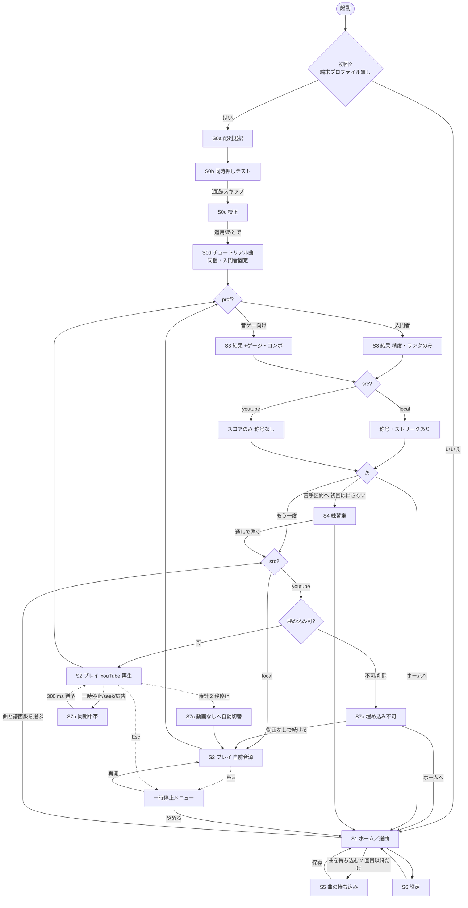

# 画面と遷移（R2 設計書・節「画面と遷移」草稿）

起草 2026-10-30。前提は ideas/R2/decisions.md。根拠は catalog の id と research/map.md の節で示す。値は節 spec、譜面の形式は節 format、順序は節 worktable、危険は節 risks に委ね、ここでは参照に留める。「推測」と書いた箇所は未測定。

## 0. 全体の約束

- 画面は 8 群 13 枚（S0 初回導線〜S7 エラー／退避）。
- 共通の状態変数は 4 つ: **初回か否か**（端末プロファイルの有無）、**プロファイル**（入門者／音ゲー向け。decisions #0）、**音源種別** `source: youtube | local`（同梱曲・持ち込み MIDI は local。business-07）、**譜面版**（配列＋同時押し上限。decisions #1・#7）。
- YouTube プレイヤーの矩形の前には何も置かない（map §2-A Required Minimum Functionality）。HUD・帯・ダイアログは矩形の外。例外なし。
- YouTube 曲のプレイ記録は端末内（IndexedDB）だけに置き、サーバーへ送らない（decisions #5）。計測の送信先・保持期間は節 risks。

## 1. 画面一覧

| id | 画面 | 役割 | 入口 | 測る |
|---|---|---|---|---|
| S0a | 配列選択 | 鍵割り当てのプリセットと刻印の確認 | 初回起動 | 所要時間、離脱、選んだ配列 |
| S0b | 同時押しテスト | 実効ロールオーバーを 10 組で測る（input-05） | S0a の次 | 離脱、通過組数、保存した上限 |
| S0c | 校正 | メトロノーム 24 打の一段目校正（feel-08） | S0b の次 | 離脱、SD、適用／不適用 |
| S0d | チュートリアル曲 | 同梱 1 曲を入門者プロファイルで通す | S0c の次 | 離脱、完走率、精度% |
| S1 | ホーム／選曲 | 曲一覧と譜面版の選択 | 2 回目以降の起動、各画面の「ホームへ」 | 選曲までの時間、フィルタ、プロファイル切替回数 |
| S2 | プレイ | 落下・判定・HUD。音源種別で 2 形態 | S1・S4・S3 | 中断の位置と理由、同期中帯の回数、動画なし切替の回数 |
| S3 | 結果 | 精度・ランク・統計・提案・次の導線 | S2 の終了 | 「練習室へ」「オフセット適用」の採択率 |
| S4 | 練習室 | 待ち・ループ・テンポ段・足場外し・ヒートマップ（m4） | S3 の苦手区間、S1 | 滞在時間、テンポ段の推移、自力率 |
| S5 | 曲の持ち込み | MIDI→譜面→同期→保存（m5） | S1（2 回目以降だけ） | 段ごとの離脱、同期タップの所要時間と残差 |
| S6 | 設定 | プロファイル・配列・幾何・判定・校正・表示 | 全画面の歯車 | 変更した項目と回数、既定へ戻した回数 |
| S7a | 埋め込み不可／削除 | onError の受け皿（critic-09） | S2 の読込 | 発生率（動画 ID 別）、動画なしで続けた率 |
| S7b | 同期中／広告中断 | 一時停止・seek・広告の合わせ直し（a-01） | S2 の再生中 | 発生回数、復帰までの時間 |
| S7c | 時計停止→動画なし | 2 秒停止の自動切替 | S2 の再生中 | 発生率、切替後の完走率 |

## 2. 遷移図

菱形が状態による分岐。`src` は音源種別、`prof` はプロファイル。

分岐のまとめ: 初回／2 回目以降（S0 か S1 か。「曲を持ち込む」「練習室で弾く」は 2 回目以降。decisions #9）、`src`（S2 の形態、S7a〜c の有無、S3 の称号、S4 のテンポ刻み、S5 の同期段。decisions #5）、`prof`（S2 の HUD・判定窓・NEAR・失敗の有無、S3 の統計の深さ、S4 の鍵数制限。decisions #6・#8）、端末の上限（S1・S5 で選べる譜面版。decisions #7）、校正の有無（S1 の表示と S3 の提案）。

## 3. 各画面

### S0 初回導線

根拠: a-03、decisions #9。目標 5 分（plan 問い 9。未実測・推測）。同期タップは出さない。4 段とも右上に「あとで」を置き、押した段を離脱として記録し、既定値で先へ進む。

| 段 | 要素 | 状態 | コピー |
|---|---|---|---|
| S0a 配列選択 | 2 枚のカード（Ableton 型＝選択済み／VMPK 型）、鍵盤図の縮小、試打欄 | getLayoutMap が取れた（Chromium・HTTPS）／取れない→刻印は選択 UI | 「キーボードを鍵盤にします」「A 段が白鍵、Q 段が黒鍵（おすすめ）」「2 段×2 で広い音域」「刻印はあとで設定から直せます」「これで始める」 |
| S0b 同時押しテスト | 10 組の指示（S+D+F、Z+X+C …）、進捗 n/10、押下キーの点灯 | 待機／組ごと／結果（上限 2／3／4） | 「同時に押せる数を調べます（30 秒）」「S・D・F を同時に押して、離してください」「このキーボードは 3 つまで同時に押せます」「次へ」「スキップ（2 つのまま）」 |
| S0c 校正 | メトロノーム（Web Audio、120 BPM）、24 打の進捗、平均と SD | SD<30 ms→適用可／SD≥30 ms→拒否（feel-08） | 「タイミングを合わせます（24 回）」「音に合わせて Space を押してください」「平均 −18 ms、ばらつき 12 ms。適用します」「ばらつきが大きいので今回は適用しません」「適用して次へ」「適用せず次へ」 |
| S0d チュートリアル曲 | S2 の入門者形態（同梱曲 1 曲・Ableton 型・上限 2・音待ち固定）。3 か所に 1 行の吹き出し | 吹き出し中は曲が止まる（音待ちなので自然） | 「光った辺の先に次のキーがあります」「セルは自分のキーにはまります」「薄い枠でつながった 2 つは同時に押します」。終了後の S3 に「はじめての結果です。次はホームから曲を選べます」 |

初回の S3 は「練習室で弾く」を隠し「ホームへ」だけ（推測: 導線を短く保つ）。測る: 段ごとの到達・完了・「あとで」、S0a 開始〜S0d 終了の所要時間。

### S1 ホーム／選曲

根拠: a-05（難度 4 軸）、critic-08（同梱曲）、decisions #1・#7。

- 上帯: プロファイル「入門者」／「音ゲー向け」（押すと切替）、端末の上限「同時押し 2」、「校正済み −18 ms」／「未校正」。
- 曲カード: 曲名、許諾（PD／CC BY／自作）、音源種別の印（「自前音源」「YouTube 再生」。文字でも書く。feel-12）、長さ、難度 4 軸の棒（密度・跳躍・同時押し・段またぎ。算出は spec）、自己ベスト、local だけ称号の印。
- 譜面版の選択: 配列（Ableton／VMPK、曲ごとの推奨を先頭）× 同時押し上限（端末の上限以下だけ。超える版は灰色で「設定の同時押しテストで解放」）。
- フィルタ「自前音源だけ」「YouTube だけ」「未クリア」。並び: おすすめ（入門者は密度の低い順）／難度／最近。
- 「曲を持ち込む」（2 回目以降だけ。decisions #9）。下帯に「練習室」「設定」。

状態: チュートリアル曲に「クリア」印。埋め込み不可を記録した YouTube 曲に「動画なしで遊べます」印。自己ベストはプロファイル×譜面版ごと（decisions #8）。コピー: 「曲をえらぶ」「自前音源・PD」「YouTube 再生・譜面は自作」「同時押し: 2 まで」。

測る: 起動〜プレイ開始の時間、フィルタと並びの使用、プロファイル切替回数、YouTube 曲と自前音源曲の選択比。

### S2 プレイ

根拠: critic-02（段別着地）、core-01／critic-01（黒鍵見立て）、core-06（辺ヒント）、tech-04（塊／殻）、a-04（配置）、feel-05／11／12、decisions #2・#3・#8。

**配置**（a-04、m0）: 左右分割を既定にする。プレイヤー矩形（既定 480×270、下限 356×200＝16:9 で 200 px 高。report §6.1）を左上、その下に HUD、右の列の全高を落下域＋鍵盤図（床）に使う。1366×768 で m0 の computeGeom を手で追うと、落下域は判定線方式で 535 px（4 段・セル 24 px）、段別着地なら最上段まで 560・最下段まで 622 px（推計）。0.5 px/ms では 1.07〜1.24 s で plan の目安 1.5 s に届かないため、**流速の既定は画面高から逆算して先読み 1.5 s を保つ**（1366×768 なら約 0.37 px/ms。値は spec）。上下配置は同じ式で 0.51〜0.68 s となり不成立。

**鍵盤図（床）**: 正六角格子（1/2 ずれ）。Ableton 型は A 段（白鍵）＋Q 段（黒鍵、30° 回転＋♯）の 2 段、VMPK 型は Z/A と Q/数字の 4 段で、A–Q の 1/4 ずれは描かず「継ぎ目」の二重線で示す（decisions #2）。段は辺の模様（実線・二重線・破線。feel-12）。上の段ほど小さく（Z 段 26 → 数字段 24 px。plan §3 m1'）。

**落下と着地**: セルは自分のキーのセルに重なった瞬間が押し時（段別着地）。辺ヒント: 今のセルの、次のキーの方向の辺が光り、離れていれば距離の数字（core-06）。和音: 隣接なら共有辺を消した塊、離れていれば薄い凸包の殻（tech-04）。ホールドはカプセル（core-10）。NEAR（入門者 1、音ゲー向け 0）のときセルが押したキーへ半分滑る。判定の返しはセル内の縁の太さ変化（2→6 px、120 ms）だけで中央のポップアップは出さない。閃光は 1 秒 3 回以下（feel-11）。

**HUD（矩形の下の左列）の違い**:

| 項目 | 入門者 | 音ゲー向け |
|---|---|---|
| 常時 | 曲名、進行バー、精度%、待ちモード名 | 曲名、進行バー、精度%、ランク、ゲージ、コンボ、ハイスピード倍率 |
| 判定ごと | 縁の太さだけ | 縁の太さ＋ FAST／SLOW の小文字（セルの脇） |
| ラベル | セル: キー文字＋音名。鍵盤図: 常時 | セル: キー文字のみ。鍵盤図: 文字のみ |
| 失敗 | 無し（decisions #8） | ゲージ 0% で終了→ S3「途中終了」 |
| 判定窓 | 24/100/180 ms＋遅れ側 1.3 倍 | 30/90/200 ms |

**待ちモード中**（入門者の既定は「音待ち」。learning-01）: 止まったセルの縁が脈動し、鍵盤図の該当キーが点灯。HUD に「音待ち: 光っているキーを押すと進みます」。YouTube 曲では動画は一時停止のままで、押した音はアプリ内ピアノ音で鳴らす（動画の音に重ねない。critic-09）。フレーズ待ちは 2 小節ごとの区切りセルに黄枠。

**同期中帯**（S7b）: 一時停止・seek・広告で時刻が飛んだら落下域の上端（矩形の外）に帯「同期中 … 再開後 300 ms は判定を猶予」を出し、セルを止める（m3 と同文言）。

**動画なしモードへの切替**（S7c）: 時計が 2 秒止まったら帯「動画が止まったので、ピアノ音で続けます（戻す）」。矩形は一時停止のまま残す（隠した再生はしない。map §2-A III.I.9）。HUD の音源印は「自前音源（動画なし）」になるが、元が youtube の曲は称号の対象外のまま（decisions #5）。

**一時停止（Esc）**: 矩形の外に「再開」「最初から」「やめる」。IME 検知で曲を止め「半角/全角キーで英数に戻してください」（input-09）。

測る: 中断の位置と理由（Esc／IME／blur）、同期中帯の回数と長さ、動画なし切替の回数、NEAR と MISS の比。

### S3 結果

根拠: a-02、tech-04 の和音統計（m1'）、feel-08（プレイ後提案）、learning-02（苦手区間）、decisions #5・#8。

| 項目 | 入門者 | 音ゲー向け |
|---|---|---|
| 精度%・ランク | 出す | 出す＋ FULL COMBO、最大コンボ、ゲージ終値 |
| 判定内訳 | ぴったり／よい／おしい／はずれ | PERFECT／GREAT／GOOD／MISS ＋ FAST／SLOW 比 |
| 和音統計 | 「同時押しが合った割合」だけ | 塊になった／殻で描いた／段をまたいだ の 3 割合 |
| 平均ずれ | 「平均 −12 ms（少し早め）」 | 平均・SD・早遅ヒストグラム |
| オフセット提案 | SD<30 ms のときだけ「オフセットを 12 ms 遅らせますか？」（lazer 型） | 同じ |
| 苦手区間 | 「ミスが集まった 2 小節: 17〜18」→「練習室で弾く」 | 同じ |
| 称号・ストリーク | local だけ「3 日連続」「初クリア」 | 同じ |
| 次の導線 | 「もう一度」「練習室で弾く」「ホームへ」 | 同じ＋「ハイスピードを変えて再挑戦」 |

youtube の曲では称号・ストリーク・ランキング送信を出さず、注記「YouTube 再生の曲は端末内だけに記録します」を置く（decisions #5）。初回は「練習室で弾く」を隠す。途中終了は見出しを「途中終了」にし精度は参考値。動画なしへ切り替わった回は「途中から動画なしで判定」。

コピー: 「結果」「精度 91.4%」「平均 +12 ms 遅れています。オフセットを合わせますか？」「合わせる」「今回は見送る」。

測る: 「合わせる」の採択率と適用後の平均ずれの変化、「練習室で弾く」「もう一度」の採択率。

### S4 練習室

根拠: learning-01／02／03／05／06、input-15、decisions #6。S2 の入門者形態に右パネルを足した画面（m4）。YouTube 曲のテンポ段は離散レート（0.5／0.75／1.0／1.25）だけで、setPlaybackRate が効かなければ「この動画ではテンポを変えられません」（map §3）。

右パネル:
- 待ち方 3 種: 「音待ち」「フレーズ待ち」「固定テンポ」。説明は m4 の文言（「音待ち: どのノートも判定線で止まり、正しいキーを押すと進みます」「固定テンポ: 止まらず、判定窓を逃すと MISS です」）。
- ループ: 帯をクリックで始点→終点。「ミス 3 回で自動ループ」「ノーミス 2 周で次へ」（learning-02）。
- テンポ段: 0.5〜1.25 の 7 段、「正答率で自動昇降」（learning-03）。1.0 倍の完走だけをクリアに記録。
- 足場外し 9 マス: 鍵盤側（キー／音名／なし）× ノート側（キー／音名／なし）。透明度「手動」「成績連動」と音高ごとの透明度バー（learning-05、m4 の grid9）。
- ヒートマップ: 「誤打の方向（6 方向の扇）」「早遅（色＋SD の輪）」を鍵盤図へ重ねる（learning-06）。
- 自力率: 「ラベル無しで当てた ÷ 判定数」と 4 区分「ラベル無し／ヒント付き／隣接許容／外した」（decisions #6 の分母）。
- 鍵数制限（入門者だけ）: 「D F J K の 4 鍵」「8 鍵」「全部」（input-15）。

状態: S3 の苦手区間から入ると 2 小節がループ済みで「1 小節前から数えて始めます」（カウントイン）。透明度は曲をまたいで保存。

コピー: 「練習室」「見本を聴く → Space で自分で弾く」「自力率 62%（ラベル無しで当てた 31／50）」。

測る: 滞在時間、テンポ段の推移、ループ回数、自力率の推移、9 マスの選択分布。

### S5 曲の持ち込み

根拠: pipeline-07／04／10、a-05、pipeline-03、m5。2 回目以降だけ入口を出す（decisions #9）。段ごとに戻れる縦積みのカード。

| 段 | 要素 | コピー |
|---|---|---|
| 1 MIDI | ドロップ欄、ファイル名、トラック数 | 「MIDI ファイル（.mid）をここに置く」「読めませんでした（SMF 形式 0/1 だけ対応）」 |
| 2 トラック | 名前・音数・音域の一覧、「合算（ドラム除く）」 | 「どのパートを弾きますか」 |
| 3 配列 | Ableton 型／VMPK 型（音域から推奨を先頭） | 「音域 C3〜G5 なので 2 段×2 をおすすめします」 |
| 4 折り畳み | 3 択「オクターブ折り返し」「範囲外カット」「近傍写像」、失われる音数、試聴 | 「配列に入らない音をどうしますか」「落とした音 15・寄せた音 17」 |
| 5 上限 | 2／3／4（端末の上限以下）、間引き前後の並び | 「和音の低音を落として 2 つまでにしました」 |
| 6 同期（youtube のときだけ） | 動画 ID、click-to-play の矩形、8 拍タップ、残差とやり直し | 「再生して、拍に合わせて Space を 8 回」「残差 9 ms。これで保存できます」「やり直す」 |
| 7 保存 | 難度 4 軸、運指の警告、曲名・作者 | 「保存して曲一覧へ」「200 ms 以内に 3 セル超える跳びが 4 か所」「持ち込んだ曲は端末内に保存されます（共有はできません）」 |

状態: 自前音源なら段 6 を飛ばす。保存した曲は S1 に「持ち込み」印で並び、譜面版は選んだ配列×上限の 1 版（他の版は S6 から再生成）。

測る: 段ごとの離脱、所要時間、同期タップのやり直し回数と残差、3 択の選択分布。

### S6 設定

根拠: plan §7 反論 10（切替を設定へ退避）、decisions の既定値。値と範囲は spec。

| カテゴリ | 項目 | 注記 |
|---|---|---|
| プロファイル | 入門者／音ゲー向け | 切替で既定値を一括で入れ替える。「既定へ戻す」あり |
| 配列 | Ableton 型／VMPK 型／対照: Wicki-Hayden、刻印の確認 | W–H は「比べるための配列」と注記（decisions #4） |
| 幾何 | 正六角（既定）／物理せん断／退避「正六角のまま文字だけで押す」、段ずれの自己申告 | 退避は鍵盤図を正六角のままにし判定を物理キーで行う（m2） |
| 着地・辺ヒント・判定窓 | 段別（既定）／一本線（対照。decisions #3）、辺ヒント ON／OFF、判定窓プリセットとホールド離し窓 | — |
| 同時押し上限 | 2／3／4、「同時押しテストをやり直す」 | 3 以上は通過した端末だけ（decisions #7） |
| 校正 | 「メトロノームで測る（24 打）」、現在のオフセット（音源種別×出力装置ごと） | SD≥30 ms なら適用しない（feel-08） |
| ラベル | セル側／鍵盤側（キー／音名／なし）、透明度リセット | S4 と同じ 9 マス |
| 色 | Okabe–Ito 3 色以内／グレースケール確認モード | 色に頼らない（feel-12） |
| 音 | ガイド音、メトロノーム、空打ち発音、音量 | 動画ありのときは「ピアノ音を重ねる」を出さない（critic-09） |
| データ | 記録の削除、持ち込み曲の削除、端末プロファイルの初期化（初回導線をやり直す） | 削除は確認ダイアログ |

コピー: 「キーボードの段ずれが画面と合わないときは、正六角のまま文字だけで押す設定にできます」「平均 −18 ms（適用中）」。

測る: 変更した項目と回数、プロファイル切替の往復、「既定へ戻す」、退避を選んだ端末の割合。

### S7 エラー／退避状態

根拠: critic-09、a-01、tech-01、decisions「時計」。すべて矩形の外に出す。

| 状態 | 検出 | 表示 | 導線 |
|---|---|---|---|
| S7a 埋め込み不可・削除 | IFrame の onError（コードは未照合。critic-09） | 落下域にカード「この動画は埋め込みで再生できません」 | 「ピアノ音で遊ぶ（動画なし）」「ホームへ」。「別の動画 ID」は後の版 |
| S7b 広告・一時停止・seek | onStateChange の BUFFERING／PAUSED、時刻の飛び 250 ms 超（a-01、m3） | 帯「同期中 … 再開後 300 ms は判定を猶予」 | 自動。復帰後の最初のセルが判定線を越えない（m3 done_when） |
| S7c 時計停止 | 動画時刻が 2 秒進まない | 帯「動画が止まったので、ピアノ音で続けます」＋「戻す」 | 自動で動画なしモード。矩形は一時停止のまま |
| タブ非表示／IME・フォーカス | visibilitychange（map §2-F）、keyCode 229、iframe へのフォーカス移動（input-09） | 帯「半角/全角キーで英数に戻してください」「画面をクリックして戻る」 | 自動一時停止 |
| 自動再生ブロック | onAutoplayBlocked（map §2-A） | 帯「動画を押して再生を始めてください」 | 利用者の操作 |

測る: 各状態の発生率（動画 ID 別・ブラウザ別）、復帰までの時間、動画なしで続けた率。

## 4. 確定事項との衝突（提案に留める）

1. フレーズ待ち（learning-01）が YouTube 曲で動画を自動で止めることは、III.F.3.b「再生ボタン以外の操作要求」に当たるかが未解決（catalog learning-01）。本案では YouTube 曲の既定を「音待ち」に置き、フレーズ待ちは残すが既定にしない。判断は節 risks へ。
2. S0b に「スキップ（2 つのまま）」を置いた。decisions #9 の 4 段は保ちつつ離脱を減らす意図（推測）。スキップも離脱として数える。
3. 先読み 1.5 s は plan の目安で、1366×768 では流速を落とさないと満たせない（§3 S2）。流速の既定を画面高から決める案を spec に出す。decisions の「セル 28 px・最小 24 px」とは衝突しない。

## 5. 他の節への参照

- 値（判定窓、流速、セル寸法、難度 4 軸の算出、計測イベント名）: 節 spec。
- 譜面 JSON（三層、譜面版の持ち方、`source` の値）: 節 format。
- 実装順（S0〜S2 と S7 を先に、S4・S5 は後）: 節 worktable。
- 法務（III.F.3.b、III.I.7／I.9、onError 未照合、記録の保持）: 節 risks。
